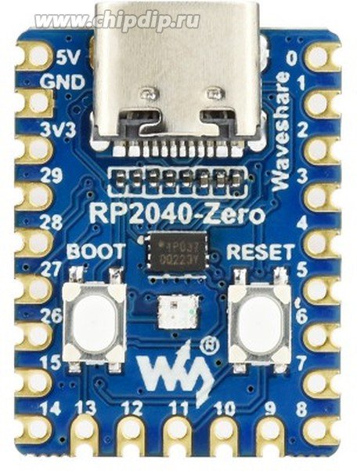
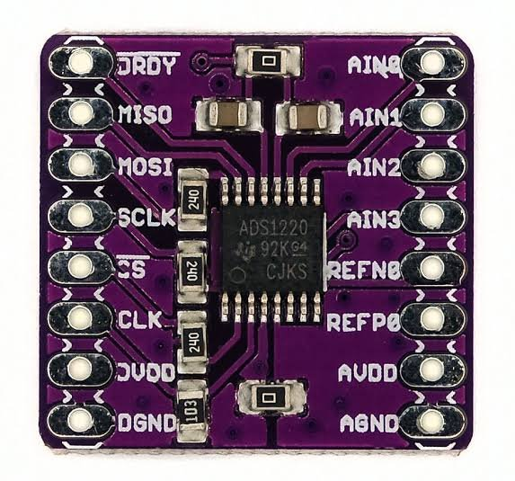

# 🏎️ SimPedal Brake — Тормозная педаль для сим-рейсинга

> Открытый проект тормозной педали для симуляторов гонок на базе **RP2040** и **24-битного АЦП ADS1220** с тензодатчиком (load cell) на 100 кг.

---

## 📋 Описание

**SimPedal Brake** — это высокоточная USB тормозная педаль для гоночных симуляторов, основанная на измерении силы нажатия тензодатчиком. В отличие от потенциометрических педалей, тензодатчик измеряет **усилие**, а не перемещение, что обеспечивает реалистичное торможение, близкое к настоящему гоночному автомобилю.

### Почему этот проект?

- **Доступность** — общая стоимость компонентов ~\$15–25 (без учёта механики и корпуса).
- **Точность** — 24-битный АЦП ADS1220 с PGA ×128 обеспечивает разрешение, недостижимое для встроенных 10/12-битных АЦП.
- **Низкая задержка** — USB HID 1000 Гц (опрос каждые 1 мс), внутренняя частота измерений 330 SPS.
- **Продвинутая фильтрация шума** — 6 алгоритмов (One-Euro, Баттерворт, Калман, Медианный, EMA, SMA) + пре-фильтр Анти-выброс с отображением точной задержки в мс.
- **Чистая разводка PCB** — 2-слойная плата с раздельной цифровой и аналоговой землёй (Star Ground), прошедшая геометрический DRC/LVS.
- **Открытость** — схемы, прошивка, конфигуратор и документация по PCB — всё в открытом доступе.

---

## ✨ Возможности

- 🎯 **24-битное разрешение** — АЦП ADS1220 с усилением PGA ×128
- ⚡ **1000 Гц USB HID** — минимальная задержка ввода (1 мс)
- 🔧 **Калибровка** — автоматическая калибровка минимума и максимума
- 🔇 **6 цифровых фильтров + Anti-Spike** — One-Euro (адаптивный), Баттерворт 2-го порядка, Калман 1D, Медианный, EMA, SMA и медианный пре-фильтр ×3 от импульсных помех
- ⏱️ **Контроль задержки (Latency)** — конфигуратор в реальном времени рассчитывает задержку фильтра и всего тракта (АЦП + Фильтр + USB) в миллисекундах
- 📈 **Кривые отклика** — линейная, прогрессивная, дегрессивная (с живой точкой на графике)
- 🛡️ **Ратиометрическое подключение** — подавление шумов питания
- 💾 **Сохранение настроек** — во flash-память RP2040 (CRC32)
- 🖥️ **GUI-конфигуратор** — обновлённый интерфейс с двухканальным осциллографом (до и после фильтра) и встроенным демо-симулятором
- 📡 **Потоковый режим** — вывод телеметрии в реальном времени (100 Гц)
- 🏗️ **Открытая конструкция** — PCB, прошивка и софт под лицензией MIT

---

## 🔩 Необходимые компоненты

<p align="center">
  
  &nbsp;&nbsp;&nbsp;&nbsp;&nbsp;&nbsp;&nbsp;&nbsp;
  
</p>
<p align="center"><i>Waveshare RP2040-Zero (слева) и модуль АЦП ADS1220 (справа)</i></p>

| Компонент | Описание | Примерная цена | Где купить |
|-----------|----------|---------------|------------|
| **Waveshare RP2040-Zero** | Микроконтроллер RP2040, USB-C | ~\$3.50 | [AliExpress](https://aliexpress.com/item/1005004644515880.html), [Waveshare](https://www.waveshare.com/rp2040-zero.htm) |
| **ADS1220 модуль** | 24-битный АЦП, breakout board | ~\$5.00 | [AliExpress](https://aliexpress.com/), [eBay](https://ebay.com/) |
| **Тензодатчик 100 кг** | Полномостовой (Wheatstone bridge) | ~\$5–10 | [AliExpress](https://aliexpress.com/) — поиск «100kg load cell» |
| **Несущая PCB** | Печатная плата проекта (см. docs/) | ~\$2 (за 5 шт.) | [JLCPCB](https://jlcpcb.com/), [PCBWay](https://pcbway.com/) |
| **Пассивные компоненты** | Резисторы, конденсаторы, ферритовая бусина | ~\$1–2 | [LCSC](https://lcsc.com/), [AliExpress](https://aliexpress.com/) |
| **Разъёмы** | Pin headers, клеммная колодка 4-pin | ~\$0.50 | [AliExpress](https://aliexpress.com/) |
| **Крепёж** | Стойки M3, винты, гайки | ~\$0.50 | Любой хозяйственный магазин |

**Итого: ~\$15–25** (без учёта механической конструкции и корпуса педали).

---

## 🔌 Схема подключения

### Таблица подключений RP2040-Zero → ADS1220

```
┌──────────────────────────────────────────────────────────┐
│          RP2040-Zero  ──────►  ADS1220 Module            │
├──────────────┬───────────────────┬───────────────────────┤
│  Пин RP2040  │   Функция        │  Пин ADS1220          │
├──────────────┼───────────────────┼───────────────────────┤
│  GP2         │   SPI0 SCK       │  SCLK                 │
│  GP3         │   SPI0 TX        │  MOSI (DIN)           │
│  GP4         │   SPI0 RX        │  MISO (DOUT)          │
│  GP5         │   GPIO (CS)      │  CS̄ (активный LOW)    │
│  GP6         │   GPIO (вход)    │  DRDY (активный LOW)  │
│  3V3         │   Питание 3.3В   │  DVDD                 │
│  3V3         │   через FB+LC    │  AVDD                 │
│  GND         │   Земля          │  DGND, AGND           │
└──────────────┴───────────────────┴───────────────────────┘
```

### Подключение тензодатчика к ADS1220

```
┌──────────────────────────────────────────────────────────┐
│        Тензодатчик  ──────►  ADS1220 Module              │
├─────────────────┬─────────────┬──────────────────────────┤
│  Провод (цвет)  │   Сигнал    │  Подключение             │
├─────────────────┼─────────────┼──────────────────────────┤
│  Красный        │   E+        │  AVDD (возбуждение 3.3В) │
│  Чёрный         │   E−        │  AGND                    │
│  Зелёный        │   S+        │  AIN0 (через 100Ω+100нФ) │
│  Белый          │   S−        │  AIN1 (через 100Ω+100нФ) │
└─────────────────┴─────────────┴──────────────────────────┘
```

> ⚠️ **Внимание:** Цвета проводов тензодатчика могут отличаться у разных производителей. Перед подключением сверьтесь с документацией вашего датчика!

---

## 🔨 Сборка прошивки

### Предварительные требования

- [Pico SDK](https://github.com/raspberrypi/pico-sdk) (v1.5+)
- CMake (≥ 3.13)
- GNU Arm Embedded Toolchain (`arm-none-eabi-gcc`)
- Git

### Установка Pico SDK

```bash
# Клонировать Pico SDK (если ещё не установлен)
git clone https://github.com/raspberrypi/pico-sdk.git
cd pico-sdk
git submodule update --init

# Установить переменную окружения
# Linux / macOS:
export PICO_SDK_PATH=/path/to/pico-sdk

# Windows (PowerShell):
$env:PICO_SDK_PATH = "C:\path\to\pico-sdk"

# Или постоянно через системные переменные
```

### Сборка

```bash
# Перейти в каталог проекта
cd rp2040pedals

# Создать каталог сборки
mkdir build
cd build

# Сгенерировать файлы сборки
cmake ..

# Собрать прошивку
make -j4
```

После успешной сборки в каталоге `build/` появится файл `pedal_brake.uf2`.
Готовая собранная прошивка также уже находится в репозитории: `firmware/dist/pedal_brake.uf2` (и в разделе [Releases](https://github.com/cenior-pomidor/SimracingPedalsRp2040/releases)).

### Прошивка RP2040-Zero

1. **Отключите** RP2040-Zero от USB.
2. **Зажмите** кнопку **BOOT** на модуле.
3. **Удерживая** кнопку, подключите USB-кабель к ПК.
4. **Отпустите** кнопку BOOT — на ПК появится USB-накопитель `RPI-RP2`.
5. **Скопируйте** файл `firmware/dist/pedal_brake.uf2` на этот диск.
6. Устройство автоматически перезагрузится и запустит прошивку.
7. Педаль определится в системе как **HID-джойстик** «SimPedal Brake» и **COM-порт**.

> 💡 **Подсказка:** Для повторной прошивки повторите шаги 1–6. Держать кнопку BOOT при каждой перепрошивке не требуется, если в прошивке реализован программный вход в режим загрузчика.

---

## 🖥️ Конфигуратор (GUI)

Графический конфигуратор позволяет настраивать педаль без ручного ввода команд.

### Запуск конфигуратора

#### Вариант 1: Готовый исполняемый файл .EXE (без установки Python)
В репозитории уже собран автономный исполняемый файл:
- Запустите файл `configurator/dist/SimPedal_Configurator.exe` двойным кликом.

#### Вариант 2: Запуск из исходного кода Python
```bash
# Перейти в каталог конфигуратора
cd configurator

# Установить зависимости Python (pyserial)
pip install -r requirements.txt

# Запустить конфигуратор
python pedal_configurator.py
```

### Возможности конфигуратора

- 📊 **Двухканальный осциллограф реального времени** — сравнение сырого сигнала АЦП (до фильтра) и очищенного выхода (после фильтра) + оценка подавления шума
- ⏱️ **Расчёт задержки фильтра (Latency, мс)** — точный расчёт добавленной задержки, времени установления 95% и общей задержки тракта (`АЦП 3.0 мс + Фильтр + USB 1.0 мс`)
- 🔇 **6 цифровых фильтров очистки шума**:
  - **Адаптивный 1€ (One-Euro)** — минимальный шум при удержании тормоза и околонулевая задержка при резком нажатии
  - **Баттерворт 2-го порядка (LPF)** — крутой спад −40 дБ/дек против ВЧ-помех и фона 50/60 Гц
  - **Фильтр Калмана 1D (Kalman)** — стабилизация удержания давления при случайном гауссовом шуме
  - **Медианный (Anti-Spike)** — устранение импульсных выбросов без размытия фронта
  - **Экспоненциальный (EMA)** и **Скользящее среднее (SMA)**
  - **+ Пре-фильтр Анти-выброс (Медиана ×3)** перед основным фильтром (+3.0 мс)
- 🎮 **Встроенный Демо-симулятор** — позволяет протестировать работу фильтров и задержки без подключённого оборудования
- 🎯 **Мастер калибровки**, **кривые отклика** с живой рабочей точкой, **мёртвая зона** и **запись во Flash**

### Последовательный протокол (для продвинутых пользователей)

Если вы предпочитаете работать через терминал (115200 бод):

```
CMD:PING                  → RSP:PONG:SimPedal:v1.1       # Проверка связи
CMD:GET_RAW               → RSP:RAW:<значение>           # Отфильтрованное значение АЦП
CMD:GET_FORCE             → RSP:FORCE:<0-65535>           # Нормированное усилие
CMD:GET_CONFIG            → RSP:CONFIG:{...}              # Текущие настройки (JSON)
CMD:CAL_MIN               → RSP:OK:CAL_MIN:<значение>     # Калибровка минимума
CMD:CAL_MAX               → RSP:OK:CAL_MAX:<значение>     # Калибровка максимума
CMD:SET_DEADZONE:500      → RSP:OK:DEADZONE:500           # Мёртвая зона (0-10000, в 0.01%)
CMD:SET_FILTER:8          → RSP:OK:FILTER:8               # Интенсивность фильтра (1-32)
CMD:SET_FILTER_TYPE:5     → RSP:OK:FILTER_TYPE:5          # 0=SMA,1=EMA,2=Med,3=Biquad,4=Kalman,5=OneEuro
CMD:SET_SPIKE_FILTER:1    → RSP:OK:SPIKE_FILTER:1         # 0=выкл, 1=анти-выброс медиана x3
CMD:SET_CURVE:1           → RSP:OK:CURVE:1                # 0=линейная, 1=прогр., 2=дегр.
CMD:SET_INVERT:0          → RSP:OK:INVERT:0               # 0=норм., 1=инвертировано
CMD:SAVE                  → RSP:OK:SAVED                  # Сохранить во flash
CMD:LOAD                  → RSP:OK:LOADED                 # Загрузить из flash
CMD:RESET_CAL             → RSP:OK:RESET                  # Сбросить калибровку
CMD:STREAM_ON             → DAT:<flt>,<force>,<raw>@100Hz # Поток (отфильтрованное, сила, сырое)
CMD:STREAM_OFF            → (остановка потока)             # Остановить поток
```

---

## 🏭 Заказ печатных плат

### JLCPCB (рекомендуется)

1. Перейдите на [jlcpcb.com](https://jlcpcb.com/).
2. Нажмите **«Quote Now»** / **«Instant Quote»**.
3. Загрузите готовый архив **Gerber**: `gerber/SimPedal_Brake_Carrier_v1.0_Gerber.zip`.
4. Параметры заказа:

   | Параметр | Значение |
   |----------|----------|
   | Слои | 2 |
   | Размер | 65 × 45 мм |
   | Количество | 5 (минимум) |
   | Толщина | 1.6 мм |
   | Медь | 1 oz |
   | Финиш | HASL (lead-free) |
   | Цвет | Зелёный / Синий / Черный |
   | Маска | С двух сторон |
   | Шелкография | Да |

5. Стоимость: **~\$2 за 5 плат** + доставка (~\$1–5).
6. Срок изготовления: 2–5 рабочих дней + доставка.

### PCBWay (альтернатива)

1. Перейдите на [pcbway.com](https://pcbway.com/).
2. Нажмите **«Quote Now»**.
3. Загрузите Gerber-файлы.
4. Укажите те же параметры, что и для JLCPCB.
5. Стоимость: **~\$5 за 5 плат** + доставка.

> 💡 **Подсказка:** При заказе через JLCPCB можно одновременно заказать SMD-сборку (SMT Assembly) — фабрика сама установит и припаяет SMD-компоненты на плату. Для этого дополнительно загрузите файлы BOM и Pick & Place (CPL).

---

## 🎯 Калибровка

### Пошаговая инструкция

1. **Подключите** педаль к ПК через USB.
2. **Откройте** конфигуратор (`python pedal_configurator.py`) или терминал.
3. **Калибровка минимума** (педаль не нажата):
   - Убедитесь, что на педаль не действует никакое усилие.
   - Отправьте команду `CMD:CAL_MIN` или нажмите кнопку «Калибровать мин.» в конфигураторе.
   - Дождитесь ответа `RSP:OK:CAL_MIN:<значение>`.
4. **Калибровка максимума** (педаль нажата полностью):
   - Нажмите на педаль с **максимальным** усилием, которое вы планируете использовать при вождении.
   - Отправьте команду `CMD:CAL_MAX` или нажмите кнопку «Калибровать макс.».
   - Дождитесь ответа `RSP:OK:CAL_MAX:<значение>`.
5. **Сохраните** настройки: `CMD:SAVE`.
6. **Проверьте** — нажимайте педаль и наблюдайте за значением `FORCE` (0–65535).

### Советы по калибровке

- 🔄 **Повторяйте калибровку** при изменении механической конструкции педали.
- ⏱️ **Дайте педали прогреться** 1–2 минуты перед калибровкой (температурный дрейф тензодатчика).
- 📉 **Мёртвая зона** — установите 1–3% (`CMD:SET_DEADZONE:100` ... `CMD:SET_DEADZONE:300`) для компенсации механического люфта.
- 📈 **Кривая отклика** — попробуйте прогрессивную (`CMD:SET_CURVE:1`) для более реалистичного ощущения торможения.

---

## ❓ Решение проблем

### Педаль не определяется в системе

| Возможная причина | Решение |
|---|---|
| Не прошита прошивка | Прошейте файл `.uf2` (см. раздел «Прошивка RP2040-Zero») |
| Неисправный USB-кабель | Попробуйте другой кабель (не все USB-C кабели передают данные!) |
| Неисправный USB-порт | Попробуйте другой порт ПК |
| Конфликт драйверов | Переустановите драйвер CDC (Windows: Диспетчер устройств → COM-порты) |

### Значение АЦП не меняется при нажатии

| Возможная причина | Решение |
|---|---|
| Не подключён тензодатчик | Проверьте подключение проводов к клеммной колодке J3 |
| Перепутаны провода | Сверьте цвета проводов с даташитом вашего тензодатчика |
| Нет SPI-связи с ADS1220 | Проверьте пайку SPI-пинов (GP2–GP5), `CMD:PING` должен возвращать `RSP:PONG` |
| ADS1220 не получает питание | Мультиметром проверьте DVDD и AVDD на модуле (должно быть ~3.3 В) |

### Шумный / нестабильный сигнал

| Возможная причина | Решение |
|---|---|
| Плохой контакт проводов | Затяните винты клеммной колодки, проверьте пайку |
| Отсутствуют RC-фильтры | Проверьте установку R1, R2, C6, C7 |
| Нет ферритовой бусины | Установите FB1 для разделения аналогового и цифрового питания |
| Длинные провода тензодатчика | Используйте экранированный кабель, экран подключите к AGND |
| Механические вибрации | Увеличьте размер фильтра: `CMD:SET_FILTER:16` или `CMD:SET_FILTER:32` |
| Помехи от мотора / блока питания | Проверьте заземление, используйте USB-изолятор при необходимости |

### Значение `FORCE` всегда 0 или 65535

| Возможная причина | Решение |
|---|---|
| Не выполнена калибровка | Выполните калибровку (см. раздел «Калибровка») |
| Перепутаны S+ и S− | Поменяйте местами зелёный и белый провода, или используйте `CMD:SET_INVERT:1` |
| Тензодатчик повреждён | Мультиметром проверьте сопротивление моста: E+↔E− и S+↔S− должны быть ~350–1000 Ом |

### COM-порт не доступен

| Возможная причина | Решение |
|---|---|
| Порт занят другой программой | Закройте все терминалы и программы, использующие этот COM-порт |
| Нет прав доступа (Linux) | `sudo usermod -a -G dialout $USER`, перезайдите в систему |
| Не установлен драйвер CDC | Windows: установите драйвер CDC (обычно устанавливается автоматически) |

### Конфигуратор не запускается

| Возможная причина | Решение |
|---|---|
| Не установлен Python | Установите Python 3.8+ с [python.org](https://python.org) |
| Не установлены зависимости | Выполните `pip install -r requirements.txt` |
| Ошибка `ModuleNotFoundError` | Убедитесь, что устанавливаете в правильное виртуальное окружение |

---

## 📁 Структура проекта

```
rp2040pedals/
├── README.md                           # Полное руководство по сборке, прошивке и настройке
├── .gitignore
├── firmware/                           # Исходный код прошивки RP2040 (C / Pico SDK)
│   ├── CMakeLists.txt                  # Файл сборки CMake
│   ├── pico_sdk_import.cmake           # Скрипт подключения SDK
│   ├── dist/
│   │   └── pedal_brake.uf2             # Готовый файл прошивки для RP2040-Zero
│   └── src/
│       ├── main.c                      # Точка входа (HID 1000 Гц, опрос АЦП, TinyUSB)
│       ├── tusb_config.h               # Конфигурация TinyUSB (композит CDC + HID)
│       ├── usb_descriptors.c / .h      # USB HID + CDC дескрипторы
│       ├── ads1220.c / .h              # Драйвер АЦП ADS1220
│       ├── filter.c / .h               # Цифровые фильтры (One-Euro, Biquad, Kalman, Median, EMA, SMA)
│       ├── config.c / .h               # Чтение/запись настроек во flash-память (CRC32)
│       └── protocol.c / .h             # Обработка команд CDC протокола
├── configurator/                       # Программа настройки для ПК (GUI)
│   ├── requirements.txt                # Зависимости Python (pyserial)
│   ├── pedal_configurator.py           # GUI-конфигуратор (Tkinter)
│   └── dist/
│       └── SimPedal_Configurator.exe   # Готовый автономный EXE-файл для Windows
├── gerber/                             # Файлы печатной платы для производства
│   ├── SimPedal_Brake_Carrier_v1.0_Gerber.zip  # Готовый ZIP-архив для JLCPCB/PCBWay
│   ├── SimPedal_Brake_Carrier_v1.0-F_Cu.gtl    # Верхний слой меди
│   ├── SimPedal_Brake_Carrier_v1.0-B_Cu.gbl    # Нижний слой меди (DGND/AGND + Star Ground)
│   ├── SimPedal_Brake_Carrier_v1.0-F_Mask.gts  # Верхняя паяльная маска
│   ├── SimPedal_Brake_Carrier_v1.0-B_Mask.gbs  # Нижняя паяльная маска
│   ├── SimPedal_Brake_Carrier_v1.0-F_Silkscreen.gto # Верхняя шелкография
│   ├── SimPedal_Brake_Carrier_v1.0-B_Silkscreen.gbo # Нижняя шелкография
│   ├── SimPedal_Brake_Carrier_v1.0-Edge_Cuts.gko    # Контур платы (65x45 мм)
│   └── SimPedal_Brake_Carrier_v1.0.drl         # Файл сверловки (Excellon)
├── pcb/
│   ├── SimPedal_Brake.kicad_pcb        # Исходный файл KiCad PCB
│   └── netlist_expected.json           # Карта цепей для DRC/LVS-проверки
├── scripts/
│   ├── generate_gerber.py              # Скрипт генерации Gerber и сверловки
│   ├── generate_kicad_pcb.py           # Генератор KiCad PCB файла
│   └── verify_pcb.py                   # Геометрический DRC + LVS-верификатор Gerber
└── docs/
    ├── pcb_design.md                   # Руководство по проектированию печатной платы
    └── images/                         # Фотографии модулей и визуализация разводки
        ├── ads1220_module.jpg
        ├── rp2040_zero.jpg
        ├── pcb_top.png
        └── pcb_bottom.png
```

---

## 📡 USB-идентификация

| Параметр | Значение |
|----------|----------|
| VID | `0x1209` (pid.codes — открытый реестр USB ID) |
| PID | `0xBEEF` |
| Устройство | Composite: HID (Joystick) + CDC (Serial) |
| Продукт | SimPedal Brake |
| Производитель | OpenSimHW |
| HID Report | 2 байта (`uint16_t`, 0–65535, ось тормоза) |
| HID Poll Rate | 1 мс (1000 Гц) |
| CDC Baud | 115200 |

---

## 📄 Лицензия

```
MIT License

Copyright (c) 2024 OpenSimHW

Данная лицензия разрешает безвозмездно любому лицу, получившему копию
данного программного обеспечения и сопутствующей документации
(далее — «Программное обеспечение»), использовать Программное обеспечение
без ограничений, включая, без ограничения, права на использование,
копирование, изменение, слияние, публикацию, распространение,
сублицензирование и/или продажу копий Программного обеспечения, а также
разрешать лицам, которым предоставляется Программное обеспечение, делать
это при соблюдении следующих условий:

Указанное выше уведомление об авторском праве и данное уведомление о
разрешении должны быть включены во все копии или существенные части
Программного обеспечения.

ПРОГРАММНОЕ ОБЕСПЕЧЕНИЕ ПРЕДОСТАВЛЯЕТСЯ «КАК ЕСТЬ», БЕЗ КАКИХ-ЛИБО
ГАРАНТИЙ, ЯВНЫХ ИЛИ ПОДРАЗУМЕВАЕМЫХ, ВКЛЮЧАЯ, НО НЕ ОГРАНИЧИВАЯСЬ
ГАРАНТИЯМИ ТОВАРНОЙ ПРИГОДНОСТИ, СООТВЕТСТВИЯ ПО НАЗНАЧЕНИЮ И
НЕНАРУШЕНИЯ ПРАВ. НИ В КАКОМ СЛУЧАЕ АВТОРЫ ИЛИ ПРАВООБЛАДАТЕЛИ НЕ НЕСУТ
ОТВЕТСТВЕННОСТИ ПО ИСКАМ О ВОЗМЕЩЕНИИ УЩЕРБА, УБЫТКОВ ИЛИ ДРУГИХ
ТРЕБОВАНИЙ, БУДЬ ТО В РАМКАХ ДОГОВОРА, ДЕЛИКТА ИЛИ ИНЫМ ОБРАЗОМ,
ВОЗНИКАЮЩИМ ИЗ, В СВЯЗИ С ПРОГРАММНЫМ ОБЕСПЕЧЕНИЕМ ИЛИ ИСПОЛЬЗОВАНИЕМ
ПРОГРАММНОГО ОБЕСПЕЧЕНИЯ ИЛИ ИНЫМИ ДЕЙСТВИЯМИ С НИМ.
```

---

## 🙏 Благодарности

- [Raspberry Pi Foundation](https://www.raspberrypi.org/) — за RP2040 и Pico SDK
- [Texas Instruments](https://www.ti.com/) — за ADS1220 и отличную документацию
- [pid.codes](https://pid.codes/) — за открытые USB VID/PID
- [TinyUSB](https://github.com/hathach/tinyusb) — за USB-стек

---

<p align="center">
  <b>Сделано с ❤️ для сообщества сим-рейсинга</b><br>
  <i>Если проект был вам полезен — поставьте ⭐ на GitHub!</i>
</p>
