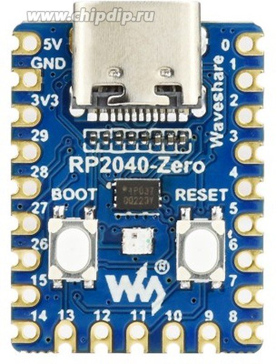
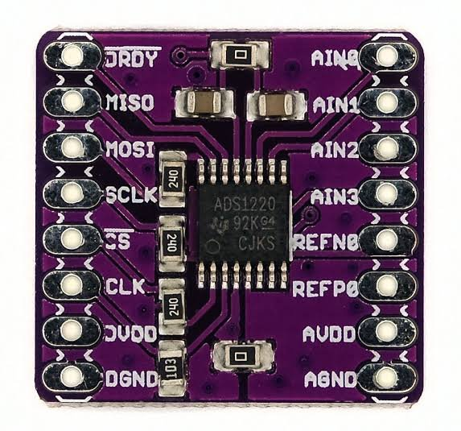
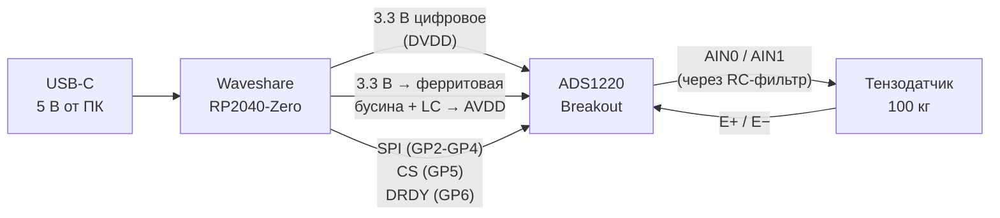
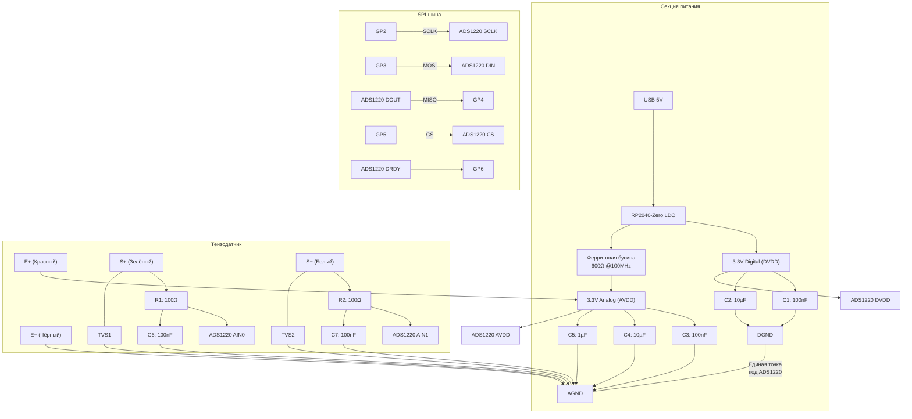
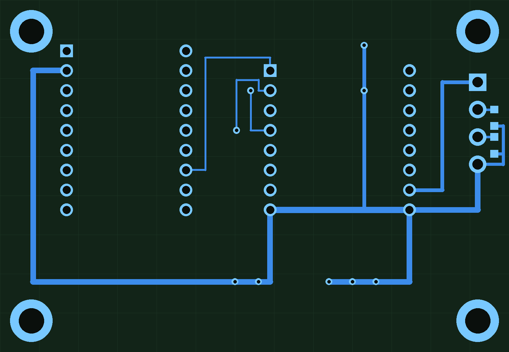
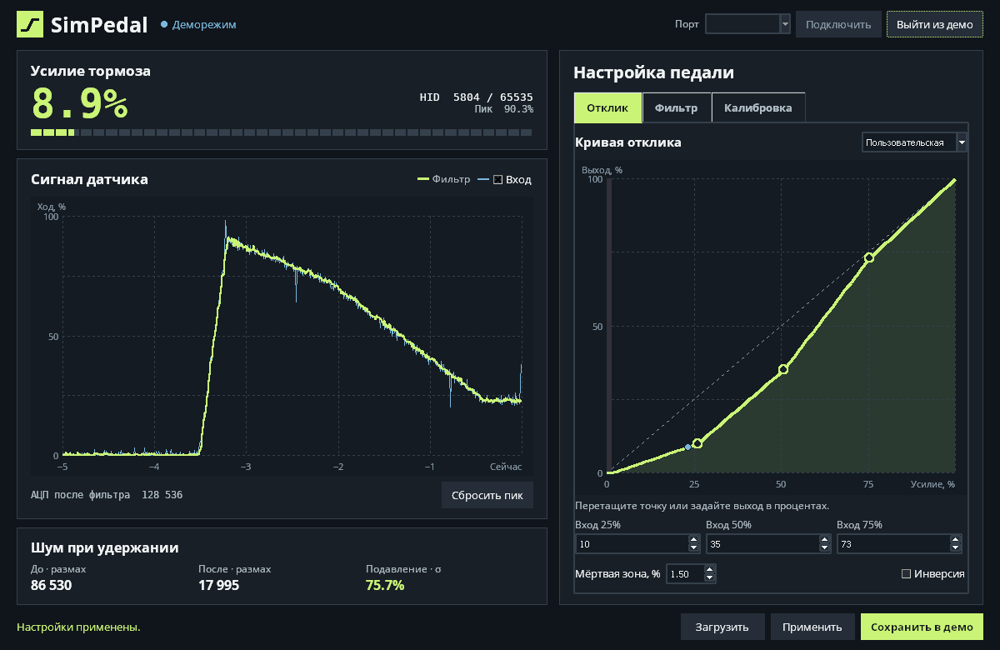

# Проектирование печатной платы — SimPedal Brake Carrier Board

## Содержание

- [1. Обзор](#1-обзор)
- [2. Схема электрическая](#2-схема-электрическая)
- [3. Спецификация компонентов (BOM)](#3-спецификация-компонентов-bom)
- [4. Рекомендации по разводке печатной платы](#4-рекомендации-по-разводке-печатной-платы)
- [5. Распиновка разъёмов](#5-распиновка-разъёмов)
- [6. Инструкция по сборке](#6-инструкция-по-сборке)
- [7. Чек-лист снижения шумов и помех](#7-чек-лист-снижения-шумов-и-помех)

---

## 1. Обзор

Несущая плата (carrier board) выполняет роль «материнской» платы проекта SimPedal Brake. Она не содержит собственного микроконтроллера и АЦП — на неё устанавливаются два готовых модуля:

<p align="center">
  
  &nbsp;&nbsp;&nbsp;&nbsp;&nbsp;&nbsp;&nbsp;&nbsp;
  
</p>
<p align="center"><i>Используемые модули: Waveshare RP2040-Zero (слева) и ADS1220 Breakout (справа)</i></p>

| Модуль | Назначение |
|---|---|
| **Waveshare RP2040-Zero** | Микроконтроллер, USB-интерфейс |
| **ADS1220 breakout module** | 24-битный АЦП, считывание тензодатчика |

Плата обеспечивает:

- Электрическое соединение модулей по SPI и линии DRDY.
- Разделение и фильтрацию аналогового и цифрового питания.
- RC-фильтрацию и ESD-защиту сигналов тензодатчика.
- Удобное подключение 100 кг тензодатчика (Wheatstone bridge) через клеммную колодку.
- Механическое крепление всей сборки (4 × M3).

> [!IMPORTANT]
> Плата рассчитана на **ратиометрическое** подключение тензодатчика: опорное напряжение АЦП = AVDD, напряжение возбуждения моста = AVDD. Это критически важно для подавления шумов питания.

---

## 2. Схема электрическая

### 2.1. Блок-схема



### 2.2. Секция питания

```
                        Carrier Board
 ┌──────────────────────────────────────────────────────────────────┐
 │                                                                  │
 │  USB 5V ──► [RP2040-Zero встроенный LDO] ──► 3.3V (цифровое)   │
 │                                                │                 │
 │                                   ┌────────────┴──────────┐      │
 │                                   │                       │      │
 │                              ┌────┴────┐            ┌─────┴───┐  │
 │                              │  DVDD   │            │  Ferrite │  │
 │                              │  domain │            │  Bead    │  │
 │                              │         │            │  600Ω    │  │
 │                              │  C1     │            │  @100MHz │  │
 │                              │  100nF  │            └─────┬───┘  │
 │                              │  C2     │                  │      │
 │                              │  10µF   │            ┌─────┴───┐  │
 │                              └─────────┘            │  AVDD   │  │
 │                                                     │  domain │  │
 │                                                     │         │  │
 │                                                     │  C3     │  │
 │                                                     │  100nF  │  │
 │                                                     │  C4     │  │
 │                                                     │  10µF   │  │
 │                                                     │  C5     │  │
 │                                                     │  1µF    │  │
 │                                                     │  керам.  │  │
 │                                                     └─────────┘  │
 │                                                                  │
 └──────────────────────────────────────────────────────────────────┘
```

**Описание секции питания:**

1. **USB 5 В** поступает через разъём USB-C модуля RP2040-Zero.
2. **Встроенный LDO** модуля RP2040-Zero вырабатывает **3.3 В** (вывод 3V3).
3. Линия 3.3 В разветвляется на:
   - **DVDD** — цифровое питание ADS1220, развязка 100 нФ ∥ 10 мкФ.
   - **AVDD** — аналоговое питание ADS1220, через ферритовую бусину (600 Ом @ 100 МГц) и LC-фильтр (100 нФ ∥ 10 мкФ ∥ 1 мкФ).
4. Земля RP2040-Zero соединена с DGND. Аналоговая ветвь соединяется с цифровой под модулем ADS1220.

### 2.3. SPI и управление

```
   RP2040-Zero                          ADS1220 Breakout
  ┌──────────┐                         ┌──────────────┐
  │      GP2 ├─── 33Ω ───────────────►│ SCLK         │
  │      GP3 ├─── 33Ω ───────────────►│ MOSI (DIN)   │
  │      GP4 │◄── 33Ω ───────────────┤ MISO (DOUT)  │
  │      GP5 ├────────────────────────►│ CS̄           │
  │      GP6 │◄──────────────────────┤ DRDY          │
  │          │                         │              │
  │      3V3 ├────┬──────────────────►│ DVDD         │
  │          │    │                    │              │
  │          │    └── FB ── LC ──────►│ AVDD         │
  │          │                         │              │
  │      GND ├───────────────────────►│ DGND / AGND  │
  └──────────┘                         └──────────────┘
```

| Сигнал | RP2040 Pin | ADS1220 Pin | Примечание |
|--------|-----------|-------------|------------|
| SCLK   | GP2 (SPI0 SCK) | SCLK | Последовательный тактовый сигнал, 33 Ом серийный резистор |
| MOSI   | GP3 (SPI0 TX)  | DIN  | Данные к АЦП, 33 Ом серийный резистор |
| MISO   | GP4 (SPI0 RX)  | DOUT | Данные от АЦП, 33 Ом серийный резистор |
| CS     | GP5 (GPIO)     | CS̄   | Выбор чипа, активный LOW, подтяжка 10 кОм к 3.3 В |
| DRDY   | GP6 (GPIO)     | DRDY | Готовность данных, активный LOW |

> [!TIP]
> R3–R5 включены последовательно. Для штатной сборки установите все три резистора по 33 Ом. Пустое посадочное место разрывает соответствующую линию SPI.

### 2.4. Интерфейс тензодатчика

```text
J3 E+ ───────── AVDD
J3 S+ ──┬── R1 (100 Ω) ──┬── AIN0
        └── TVS1 ── GND   └── C6 (100 нФ) ── GND
J3 S− ──┬── R2 (100 Ω) ──┬── AIN1
        └── TVS2 ── GND   └── C7 (100 нФ) ── GND
J3 E− ───────── AGND
```

**Компоненты фильтра сигнальных линий (на каждый канал):**

| Компонент | Номинал | Назначение |
|-----------|---------|------------|
| R (серии) | 100 Ом | Ограничение тока, часть RC-фильтра (fc ≈ 16 кГц) |
| C (к земле)| 100 нФ | Фильтрация ВЧ-помех, часть RC-фильтра |
| TVS диод  | PESD5V0S1BA или аналог | Защита от ESD и выбросов |

> Частота среза RC-фильтра: $f_c = \frac{1}{2\pi \cdot 100 \cdot 100 \times 10^{-9}} \approx 15{,}9\ \text{кГц}$
>
> Это существенно выше рабочей полосы (330 SPS ≈ 165 Гц по Найквисту), поэтому полезный сигнал не ослабляется.

### 2.5. ESD-защита

TVS1 и TVS2 на обороте платы 1.2 отводят разряд с S+ и S− к земле у J3. Для этих посадочных мест выбран двунаправленный PESD5V0S1BA в корпусе SOD-323. Линии USB размещены на самом модуле RP2040-Zero. [Спецификация TVS](https://www.nexperia.com/product/PESD5V0S1BA)

### 2.6. Полная схема (сводная)



---

## 3. Спецификация компонентов (BOM)

| # | Обозначение | Компонент | Номинал / Параметры | Корпус | Кол-во | Примерная цена (USD) |
|---|-------------|-----------|---------------------|--------|--------|---------------------|
| 1 | U1 | Waveshare RP2040-Zero | RP2040, USB-C, встроенный LDO | Модуль на двух рядах по 9 выводов | 1 | ~3.50 |
| 2 | U2 | ADS1220 Breakout Module | 24-bit ADC, SPI | Module | 1 | ~5.00 |
| 3 | FB1 | Ферритовая бусина | 600 Ом @ 100 МГц, ≥200 мА | 0805 | 1 | ~0.05 |
| 4 | C1 | Керамический конденсатор | 100 нФ, 25 В, X7R | 0805 | 1 | ~0.02 |
| 5 | C2 | Керамический конденсатор | 10 мкФ, 10 В, X5R | 0805 | 1 | ~0.05 |
| 6 | C3 | Керамический конденсатор | 100 нФ, 25 В, X7R | 0805 | 1 | ~0.02 |
| 7 | C4 | Керамический конденсатор | 10 мкФ, 10 В, X5R | 0805 | 1 | ~0.05 |
| 8 | C5 | Керамический конденсатор | 1 мкФ, 25 В, X7R | 0805 | 1 | ~0.03 |
| 9 | C6 | Керамический конденсатор | 100 нФ, 25 В, X7R, **C0G/NP0 если доступен** | 0805 | 1 | ~0.03 |
| 10 | C7 | Керамический конденсатор | 100 нФ, 25 В, X7R, **C0G/NP0 если доступен** | 0805 | 1 | ~0.03 |
| 11 | R1 | Резистор | 100 Ом, 1%, металлоплёночный | 0805 | 1 | ~0.01 |
| 12 | R2 | Резистор | 100 Ом, 1%, металлоплёночный | 0805 | 1 | ~0.01 |
| 13 | R6 | Резистор (pullup CS) | 10 кОм, 5% | 0805 | 1 | ~0.01 |
| 14 | R3–R5 | Резистор (серийные SPI) | 33 Ом, 5% | 0805 | 3 | ~0.03 |
| 15 | TVS1, TVS2 | TVS-диод | PESD5V0S1BA | SOD-323 | 2 | ~0.20 |
| 16 | J1 | Гребёнка штыревая (RP2040-Zero) | 2×9 pin, шаг 2.54 мм | THT | 2 шт × 9 pin | ~0.30 |
| 17 | J2 | Гребёнка штыревая (ADS1220) | 2×8 pin, шаг 2.54 мм | THT | 2 шт × 8 pin | ~0.25 |
| 18 | J3 | Клеммная колодка (тензодатчик) | 4-pin, шаг 3.5 мм | THT | 1 | ~0.30 |
| 20 | — | Крепёж | Стойка M3×6 + гайка | — | 4 комплекта | ~0.40 |
| 21 | — | Печатная плата | 65 × 45 мм, 2 слоя, 1.6 мм, HASL | — | 1 (мин. 5 шт.) | ~2.00 (за 5 шт) |

**Итого (приблизительно):** ~\$12–15 за один комплект (без учёта тензодатчика).

> [!TIP]
> Для конденсаторов C6 и C7 (RC-фильтр сигналов тензодатчика) используйте **C0G/NP0** диэлектрик, если доступен. Он имеет значительно меньший температурный дрейф и пьезоэлектрический эффект, чем X7R, что снижает механически наведённые шумы.

---

## 4. Рекомендации по разводке печатной платы

### 4.1. Общие параметры

| Параметр | Значение |
|----------|----------|
| Размер платы | 65 × 45 мм |
| Количество слоёв | 2 (Top + Bottom) |
| Толщина | 1.6 мм (стандарт) |
| Медь | 1 oz (35 мкм) |
| Финиш | HASL (lead-free) или ENIG |
| Минимальный зазор | 0.2 мм |
| Минимальная дорожка | 0.2 мм |

### 4.2. Ширина дорожек

| Тип трассы | Ширина | Примечание |
|------------|--------|------------|
| Питание и земля | 0.3–0.8 мм | Отводы питания, земляные шины и перемычка под ADS1220 |
| SPI-сигналы (SCLK, MOSI, MISO, CS) | 0.25 мм | С серийными резисторами |
| DRDY | 0.25 мм | — |
| Аналоговые сигналы (AIN0, AIN1) | 0.30 мм | Два входа через отдельные RC-цепи |
| Возбуждение моста (E+, E−) | 0.5 / 0.7 мм | От AVDD и AGND к клеммнику |

### 4.3. Компоновка компонентов

RP2040-Zero устанавливается в J1 слева, USB-C направлен к верхнему краю платы. Розетка J2 расположена в центре, клеммник J3 справа. Резисторы и конденсаторы устанавливаются со стороны модулей, TVS1 и TVS2 — с оборотной стороны у контактов J3.

### 4.4. Земля

На нижнем слое проложены две земляные шины. Цифровая ветвь идёт от J1 к DGND, аналоговая соединяет AGND, конденсаторы входов и E−. Под J2 проходит перемычка шириной 0.8 мм. Четыре крепёжных отверстия электрически изолированы от сигнальных цепей и земли.

### 4.5. Производственные файлы

Редактируемая плата находится в `pcb/SimPedal_Brake.kicad_pcb`. Команда `python scripts/generate_gerber.py` запускает DRC в KiCad 9, экспортирует Gerber и метрическую сверловку с десятичной точкой, затем сверяет медь с картой выводов. Архив для заказа — `gerber/SimPedal_Brake_Carrier_v1.2_Gerber.zip`.

Для восстановления исходной компоновки из параметров служит `python scripts/generate_kicad_pcb.py`. Эта команда перезаписывает файл платы. После ручной правки в KiCad для изготовления достаточно запуска генератора Gerber.

### 4.6. Рекомендации по слоям (2-layer)

| Слой | Содержимое |
|------|-----------|
| **Top (лицевой)** | R1–R6, C1–C7, FB1, сигнальные дорожки, питание AVDD/DVDD |
| **Bottom (оборотный)** | TVS1/TVS2, шины DGND и AGND с перемычкой Star Ground под ADS1220, переходы SPI/DRDY/AVDD |

<p align="center">
  
  &nbsp;&nbsp;&nbsp;&nbsp;
  
</p>
<p align="center"><i>Визуализация трассировки платы 65 × 45 мм (DRC/LVS: 0 пересечений, 0 обрывов, зазор ≥ 0.45 мм): слева — Top (F_Cu), справа — Bottom (B_Cu)</i></p>

> [!TIP]
> Если бюджет позволяет 4-слойную плату, используйте:
> Layer 1 — сигналы, Layer 2 — сплошной GND, Layer 3 — питание, Layer 4 — сигналы/GND. Это существенно улучшит помехозащищённость.

---

## 5. Распиновка разъёмов

### 5.1. J1 — Гребёнка RP2040-Zero (2 × 9 pin)

Вид со стороны компонентов, USB-C у верхнего края платы.

| Левый контакт | Сигнал | Правый контакт | Сигнал |
|---|---|---|---|
| 1 | 5V | 2 | GP0 |
| 3 | GND | 4 | GP1 |
| 5 | 3V3 | 6 | GP2 |
| 7 | GP29 | 8 | GP3 |
| 9 | GP28 | 10 | GP4 |
| 11 | GP27 | 12 | GP5 |
| 13 | GP26 | 14 | GP6 |
| 15 | GP15 | 16 | GP7 |
| 17 | GP14 | 18 | GP8 |

**Используемые пины RP2040-Zero:**

| GPIO | Функция | Подключение на плате |
|------|---------|---------------------|
| GP2 | SPI0 SCK | → R(33Ω) → ADS1220 SCLK |
| GP3 | SPI0 TX  | → R(33Ω) → ADS1220 DIN |
| GP4 | SPI0 RX  | ← R(33Ω) ← ADS1220 DOUT |
| GP5 | GPIO (CS) | Напрямую к ADS1220 CS̄, подтяжка R6 (10 кОм) к 3V3 |
| GP6 | GPIO (DRDY) | ← ADS1220 DRDY |
| 3V3 | Питание 3.3V | → DVDD + (FB1 →) AVDD |
| GND | Земля   | → DGND / AGND |

### 5.2. J2 — Гребёнка ADS1220 Module (2 × 8 pin)

| Левый контакт | Сигнал | Правый контакт | Сигнал |
|---|---|---|---|
| 1 | DRDY | 2 | AIN0 |
| 3 | MISO (DOUT) | 4 | AIN1 |
| 5 | MOSI (DIN) | 6 | AIN2 (NC) |
| 7 | SCLK | 8 | AIN3 (NC) |
| 9 | CS̄ | 10 | REFN0 (NC) |
| 11 | CLK → DGND | 12 | REFP0 (NC) |
| 13 | DVDD | 14 | AVDD |
| 15 | DGND | 16 | AGND |

CLK соединён с DGND для внутреннего генератора ADS1220. NC обозначает свободный вывод.

### 5.3. J3 — Клеммная колодка тензодатчика (4 pin)

| Пин | Маркировка | Цвет провода | Подключение |
|-----|-----------|-------------|-------------|
| 1 | E+ | Красный | AVDD (3.3V возбуждение) |
| 2 | S+ | Зелёный | → R1(100Ω) → AIN0 |
| 3 | S− | Белый | → R2(100Ω) → AIN1 |
| 4 | E− | Чёрный | AGND |

> [!WARNING]
> Цвета проводов тензодатчика могут различаться у разных производителей! Перед подключением проверьте даташит вашего конкретного датчика. Типичная цветовая схема (красный/чёрный/зелёный/белый) используется чаще всего, но встречаются и другие варианты.

### 5.4. Внешний переходник RJ45 (опционально)

Внешний переходник можно подключить проводами к J3. Пример распиновки кабеля:

| Пин RJ45 | Сигнал | Цвет (T-568B) |
|-----------|--------|----------------|
| 1 | E+ (возбуждение +) | Бело-оранжевый |
| 2 | E− (возбуждение −) | Оранжевый |
| 3 | S+ (сигнал +) | Бело-зелёный |
| 4 | NC | — |
| 5 | NC | — |
| 6 | S− (сигнал −) | Зелёный |
| 7 | Shield / GND | — |
| 8 | Shield / GND | — |

---

## 6. Инструкция по сборке

### 6.1. Необходимые инструменты

- Паяльная станция (рекомендуется с регулировкой температуры, 300–350 °C)
- Припой ∅0.5–0.8 мм (Sn63/Pb37 или бессвинцовый SAC305)
- Флюс (жидкий или гелевый, канифольный RMA)
- Пинцет (прямой и изогнутый)
- Лупа или микроскоп (для SMD 0805)
- Мультиметр
- Изопропиловый спирт и щётка (для очистки)

### 6.2. Порядок пайки

> [!IMPORTANT]
> Всегда паяйте **от низких компонентов к высоким**. Сначала SMD, затем THT-разъёмы, в последнюю очередь — модули.

**Шаг 1 — SMD-компоненты (нижняя сторона, если применимо):**

Установите TVS1 (S+) и TVS2 (S−) под клеммником J3 на плате 1.2. Двунаправленный PESD5V0S1BA допускает обе ориентации. На ранее изготовленных платах без этих площадок этот шаг пропускают.

**Шаг 2 — SMD-компоненты (верхняя сторона):**

1. Ферритовая бусина **FB1** (0805).
2. Резисторы **R1**, **R2** (100 Ом, 0805).
3. **R6** — подтяжка CS к DVDD, 10 кОм (0805).
4. **R3, R4, R5** — последовательно в SCK, MOSI, MISO соответственно, по 33 Ом (0805).
5. Конденсаторы **C1–C7** (0805) — начинайте с 100 нФ, затем 10 мкФ.

**Шаг 3 — Проверка после SMD:**

- Визуальный осмотр под увеличением.
- Прозвонка мультиметром: убедиться, что нет замыканий между 3.3V и GND.
- Проверьте целостность FB1 между DVDD и AVDD. Мультиметр показывает малое сопротивление постоянному току. Номинал 600 Ом указан для частоты 100 МГц.

**Шаг 4 — THT-разъёмы:**

1. Впаять **гребёнки-розетки** для J1 (RP2040-Zero, 2 × 9 pin).
2. Впаять **гребёнки-розетки** для J2 (ADS1220, 2 × 8 pin).
3. Впаять **клеммную колодку J3** (4-pin).
4. Закрепить плату винтами M3 на стойках.

**Шаг 5 — Промежуточная проверка:**

1. Подключить RP2040-Zero (без ADS1220 и тензодатчика).
2. Подключить USB к ПК.
3. Мультиметром проверить:
   - **DVDD** = 3.3 В ± 0.1 В (на контактах J2 pin 13).
   - **AVDD** = 3.3 В ± 0.1 В (на контактах J2 pin 14).
   - **GND** = 0 В.
4. Если напряжения в норме — перейти к следующему шагу.

**Шаг 6 — Установка модулей:**

1. Вставить **ADS1220 breakout** в розетки J2.
2. Вставить **RP2040-Zero** в розетки J1 (если ещё не вставлен).
3. Убедиться, что оба модуля надёжно сидят, все пины в контакте.

**Шаг 7 — Подключение тензодатчика:**

1. Зачистить провода тензодатчика на ~5 мм.
2. Подключить по цветовой маркировке в клеммную колодку J3:
   - Пин 1 (E+): **Красный**
   - Пин 2 (S+): **Зелёный**
   - Пин 3 (S−): **Белый**
   - Пин 4 (E−): **Чёрный**
3. Затянуть винты клеммной колодки.

**Шаг 8 — Финальная проверка и прошивка:**

1. Отключить USB.
2. Удерживая кнопку BOOT на RP2040-Zero, подключить USB — устройство определится как USB-накопитель.
3. Скопировать файл `firmware/dist/pedal_brake.uf2` на появившийся диск.
4. Устройство перезагрузится и запустит прошивку.
5. Запустить [конфигуратор Windows](../configurator/dist/SimPedal_Configurator.exe), выбрать COM-порт педали и нажать **Подключить**. Для проверки через терминал (115200 бод) команда `CMD:PING` возвращает `RSP:PONG:SimPedal:v1.2`.

**Настройка отклика и фильтра**

На вкладке **Отклик** перетащите точку по вертикали или введите выход для 25, 50 и 75% рабочего хода после мёртвой зоны. Например, значение 35 для среднего узла даёт 35% торможения при половине рабочего хода. Изменения сразу действуют на USB-ось. Кнопка **Сохранить во Flash** сохраняет профиль после отключения питания. Редактор точек требует прошивку 1.2.

Для сравнения фильтров выберите алгоритм и силу на вкладке **Фильтр**, затем удерживайте педаль при постоянном усилии. Монитор показывает исходный и обработанный сигналы и оценивает снижение шума по разбросу отсчётов при удержании. Во время нажатия индикатор может показывать **Движение**. Чтобы проверить весь тракт без цифровой фильтрации, установите силу 1 и отключите анти-выброс.



---

## 7. Чек-лист снижения шумов и помех

Данный чек-лист суммирует все меры по борьбе с электромагнитными помехами и шумами, реализованные в конструкции платы.

### Питание

- [ ] Ферритовая бусина (600 Ом @ 100 МГц) между цифровым и аналоговым 3.3 В
- [ ] Развязочные конденсаторы 100 нФ + 10 мкФ на DVDD
- [ ] Развязочные конденсаторы 100 нФ + 10 мкФ + 1 мкФ на AVDD
- [ ] Конденсаторы расположены максимально близко к выводам питания модулей
- [ ] 100 нФ — ближе к выводу, 10 мкФ — чуть дальше

### Земля

- [ ] Целостность обеих земляных ветвей
- [ ] Единственная точка соединения AGND/DGND — под ADS1220
- [ ] Крепёжные кольца изолированы от GND

### Аналоговые сигналы

- [ ] RC-фильтр на каждом сигнальном проводе тензодатчика (100 Ом + 100 нФ, fc ≈ 16 кГц)
- [ ] Конденсаторы RC-фильтра — C0G/NP0 (если доступны)
- [ ] S+ приходит на AIN0, S− на AIN1
- [ ] Аналоговые дорожки максимально короткие
- [ ] Аналоговые дорожки не проходят под/рядом с цифровыми сигналами
- [ ] TVS-диоды на сигнальных линиях тензодатчика

### Цифровые сигналы

- [ ] Серийные резисторы 33 Ом на SPI-линиях (SCLK, MOSI, MISO)
- [ ] Подтяжка 10 кОм на CS к 3.3 В
- [ ] SPI-дорожки не проходят через аналоговую зону
- [ ] Дорожки SPI по возможности имеют обратный путь по земле непосредственно под ними

### Компоновка

- [ ] Порядок компонентов: цифровое → смешанное → аналоговое
- [ ] Клеммная колодка тензодатчика — на краю аналоговой зоны

### Ратиометрическая схема

- [ ] Опорное напряжение ADS1220 = AVDD (REG2 = 0xC0)
- [ ] Возбуждение моста = AVDD
- [ ] Колебания AVDD одинаково влияют на сигнал и опору → шумы компенсируются

### Режим АЦП

- [ ] При 330 отсчётах/с в обычном режиме биты FIR[1:0] равны 00 (REG2 = 0xC0). Режим одновременного подавления 50/60 Гц предусмотрен для 20 отсчётов/с в обычном режиме или 5 в duty-cycle. [ADS1220, регистр 2](https://www.ti.com/lit/ds/symlink/ads1220.pdf#page=45)
- [ ] PGA gain = 128 для максимального разрешения при малом сигнале тензодатчика
- [ ] Непрерывный режим преобразования (Continuous, REG1 = 0x84)

---

> **Дата создания документа:** 2024  
> **Проект:** SimPedal Brake — открытый проект сим-рейсинг тормозной педали  
> **Лицензия:** MIT
